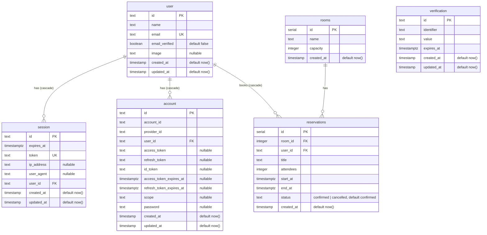

# ER 図

`apps/api/src/infrastructure/db/schema.ts` と `apps/api/drizzle/` のマイグレーションに基づく DB 構造です。
スキーマを変更したらこの図も合わせて更新してください。

- 注記のないカラムはすべて `NOT NULL`
- `timestamptz` は `timestamp with time zone`、`timestamp` はタイムゾーンなし
- `verification` は他テーブルへの FK を持たない（Better Auth のメール検証などで使用）

## 外部キー

| FK | 参照先 | ON DELETE |
| --- | --- | --- |
| `session.user_id` | `user.id` | `CASCADE` |
| `account.user_id` | `user.id` | `CASCADE` |
| `reservations.user_id` | `user.id` | `CASCADE` |
| `reservations.room_id` | `rooms.id` | `NO ACTION`（予約が残っている会議室は削除不可） |

## ユニーク制約・インデックス

| 名前 | テーブル | カラム |
| --- | --- | --- |
| `user_email_unique` | `user` | `email` |
| `session_token_unique` | `session` | `token` |
| `reservations_room_time_idx` | `reservations` | `room_id, start_at, end_at`（btree。重複チェック用） |
